
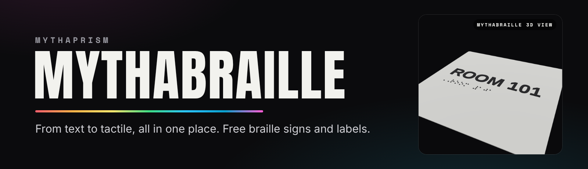

<a href="https://mythaprism.com/braille"><b>Open MythaBraille</b></a> &nbsp;·&nbsp;
<a href="docs/quick-start.md"><b>Quick start</b></a> &nbsp;·&nbsp;
<a href="manual/MythaBraille_Manual.pdf"><b>Manual (PDF)</b></a> &nbsp;·&nbsp;
<a href="demos"><b>Demo plates to print</b></a> &nbsp;·&nbsp;
<a href="../../issues/new/choose"><b>Report a bug</b></a>

MythaBraille makes braille signs and labels you can 3D print. You type your text, MythaBraille writes the braille under it, and you export a file for your slicer. It is free, and it runs in your browser. Nothing you type is sent anywhere.

This repository holds the manual, the demo plates and the pictures. It holds no source code.

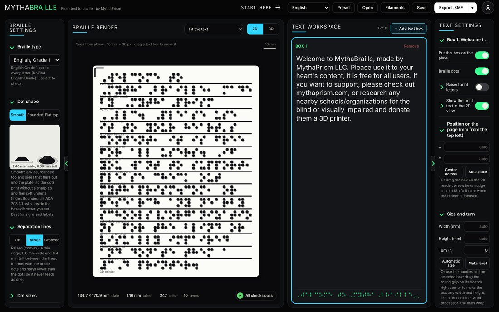

Real screen capture of MythaBraille.

## What it makes

| A room sign | A pantry label | A sign with lines |
|:---:|:---:|:---:|
| 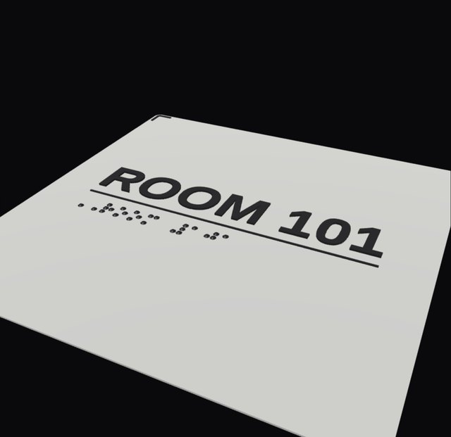 | 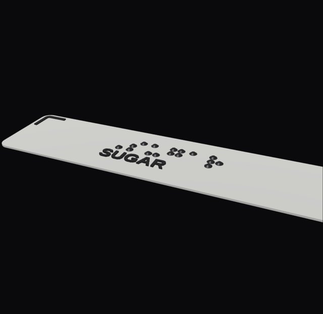 | 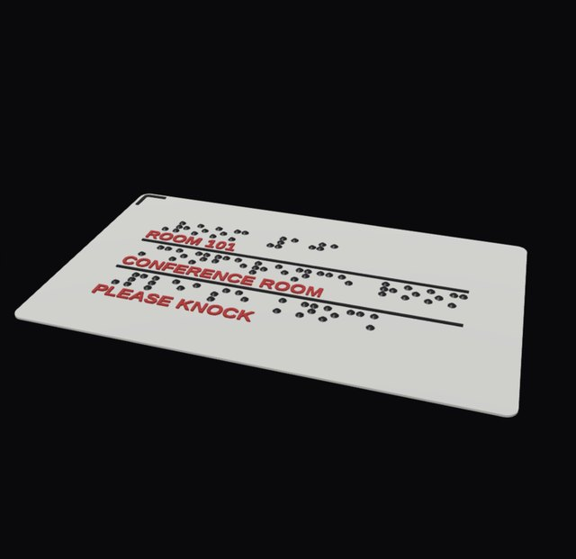 |

The 3D view in MythaBraille (real screen captures).

## See it turn

| A room sign | Raised separation lines | Grooved separation lines |
|:---:|:---:|:---:|
| 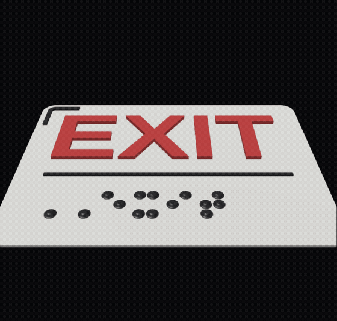 | 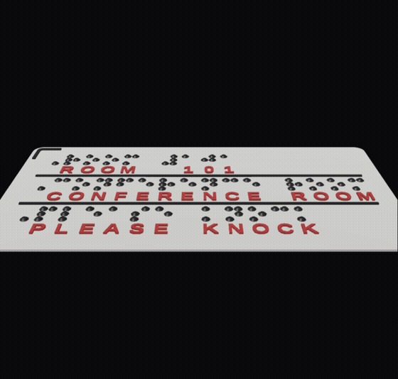 | 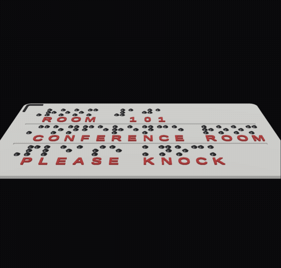 |

The 3D view in MythaBraille 1.6.5 (real screen recordings).

## Dot shapes

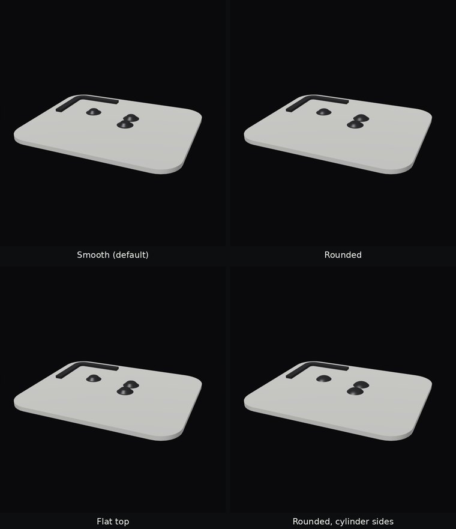

Smooth is the default: a wide, rounded top with a foot that flares into the plate, so the dots print without a sharp tip. Rounded and Flat top are there too.

## Your colors

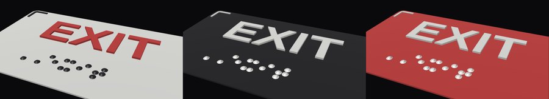

Pick a filament for the plate, one for the dots and one for the raised letters. With one nozzle and no AMS, MythaBraille can pause the print so you can swap the filament.

## New to braille?

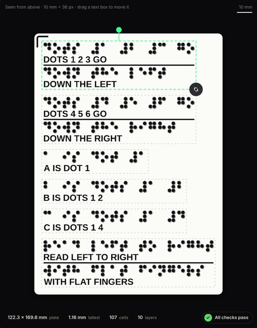

The [manual](manual/MythaBraille_Manual.pdf) starts with what braille is and how to read it, then walks through every setting and how to print in Bambu Studio, OrcaSlicer and PrusaSlicer. Inside MythaBraille, the person icon at the top right has a walkthrough that makes your first plate with you.

 

## Guides

- [Quick start: your first plate](docs/quick-start.md)
- [The full manual as a page](docs/manual.md), with pictures, or as a [PDF](manual/MythaBraille_Manual.pdf)

## Demo plates

Ready to print, each for Bambu Studio and OrcaSlicer and for PrusaSlicer, in [demos/](demos):

- Test Staircase
- Alphabet
- Colors for clothes
- Days of the week
- First words
- How to read braille
- Kitchen labels
- Name badge
- Numbers

## On your phone

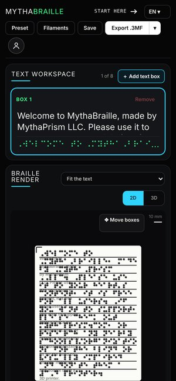

MythaBraille works in the browser on phones and tablets too.

 

## Before you hang a sign

Braille on public signs has rules (in the US, ADA section 703). MythaBraille checks your plate against them and tells you what to fix, but it does not replace a braille transcriber. Please have a sign checked before it goes up.

## License

MythaBraille is free to use for anything, including commercial work. What you make with it is yours. You may share complete, unchanged copies, and you may not sell it or share changed versions. The full text is in [LICENSE](LICENSE).

MythaBraille is made by MythaPrism LLC. MYTHAPRISM™ is a trademark of MythaPrism LLC. See [TRADEMARKS.md](TRADEMARKS.md).
