# MythaBraille manual

The same text as the [PDF manual](../manual/MythaBraille_Manual.pdf). The pictures are real screen captures of MythaBraille.

## About MythaBraille

**From text to tactile, all in one place.**

MythaBraille is a free tool that turns your text into braille you can 3D print. You type, it shows you the braille as you go, and then it hands your slicer a file that prints the plate, the dots and any raised letters in their own filaments. It runs in your web browser at mythaprism.com/braille, on your own device, so nothing you type is ever uploaded.

**What braille is.** Braille is a way of writing that people read with their fingertips. Each letter, number or sign is one cell of up to six raised dots in two columns of three, and the dots are numbered 1, 2, 3 down the left column and 4, 5, 6 down the right. Louis Braille published the system in 1829, and today it is read all over the world.

**Why we made it.** Braille signs and pages usually come from sign shops and braille embossers, and even a small braille embosser starts at about $1,800 (American Foundation for the Blind). A desktop 3D printer can make simple braille labels, cards and signs from a few grams of filament, so we made MythaBraille free for anyone who has one. Say you are a parent labeling things around the house, a student learning the alphabet, a teacher making flash cards, or a library or makerspace helping its visitors, MythaBraille is for you.

**What it helps with.** Labels for the kitchen and the closet, learning cards for the alphabet and numbers, name badges, door and room labels, greeting cards and art. Braille becomes quick to try and cheap to print, and if you want to change something you just change the text and print it again.

**Why it is easy.** You type plain text, and MythaBraille sizes every dot and gap for you, sets the filaments and the layer heights, and checks the plate before you print. There is no account to make, nothing to install and nothing to pay.

**What it is not.** MythaBraille is not made, sponsored, certified, approved or endorsed by the U.S. Access Board, the U.S. Department of Justice, the Braille Authority of North America or any other authority. The right sizes alone do not make a sign meet the ADA or any building code, and the braille it makes can be wrong (Grade 2 is still a beta), so have anything people will rely on checked by a qualified braille reader.

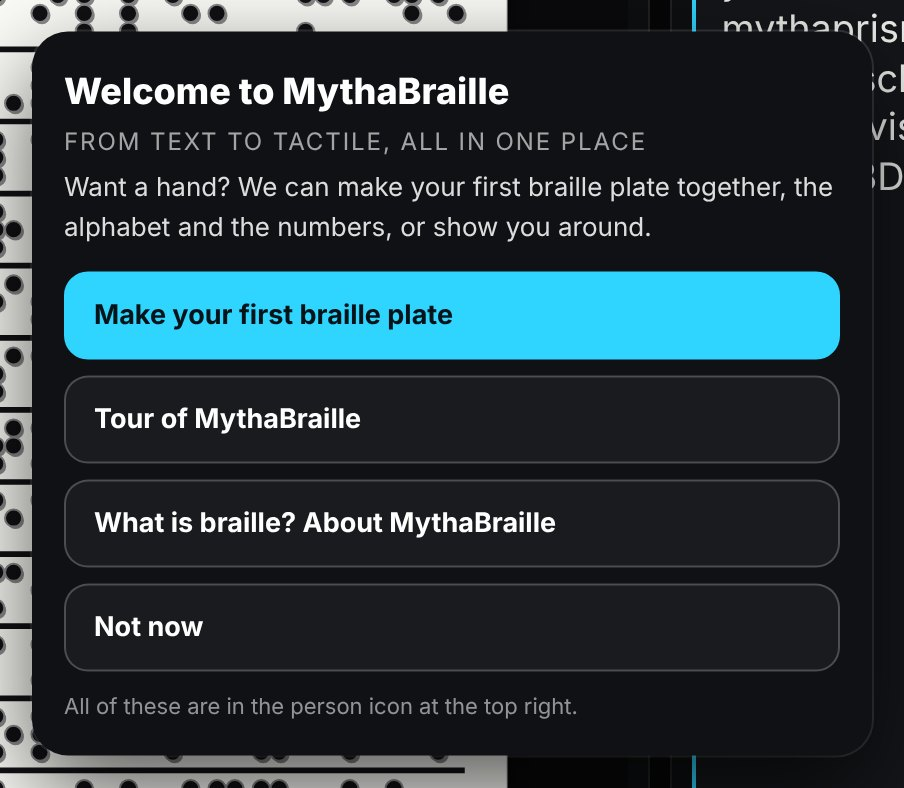

The welcome card on a first visit: make your first plate, a tour, or read what braille is. Real screen capture of MythaBraille.

## Braille basics for beginners

**The cell.** Every braille character is one cell with six places for dots. Dots 1, 2 and 3 run down the left side and dots 4, 5 and 6 run down the right side.

**The first ten letters.** a is dot 1. b is dots 1 2. c is dots 1 4. d is dots 1 4 5. e is dots 1 5. f is dots 1 2 4. g is dots 1 2 4 5. h is dots 1 2 5. i is dots 2 4. j is dots 2 4 5.

**The next letters.** k to t are the same as a to j with dot 3 added, and u, v, x, y and z are a to e with dots 3 and 6 added. w is the odd one out at dots 2 4 5 6, because French braille had no w when the system was made.

**Numbers.** A number sign (dots 3 4 5 6) in front of a to j turns them into 1 to 9 and 0, so 1 is the number sign followed by a.

**Capitals.** A capital sign (dot 6) in front of a letter makes it a capital.

**Grade 1 and Grade 2.** Grade 1 spells out every letter. Grade 2 (contracted braille) uses short forms for common words and letter groups, and it is what most adult readers and US signs use. MythaBraille makes Grade 1, and Grade 2 as a beta with the full set of Unified English Braille contractions, including shortforms inside longer words like friendship and blindness. It also makes Spanish braille, where á é í ó ú ü ñ and ¿ ¡ have their own signs, and Arabic braille with letters, short vowels, shadda and digits, and both of those are betas too. Have every beta checked by someone who reads that braille before it goes on a sign.

**Reading with your fingers.** Use the pads of your fingers, not the tips, and keep your hands flat and relaxed while you move left to right along a line without pressing hard. Two hands help, because one can read while the other finds the next line. A good way to start is the alphabet plate, saying each letter out loud as you feel it.

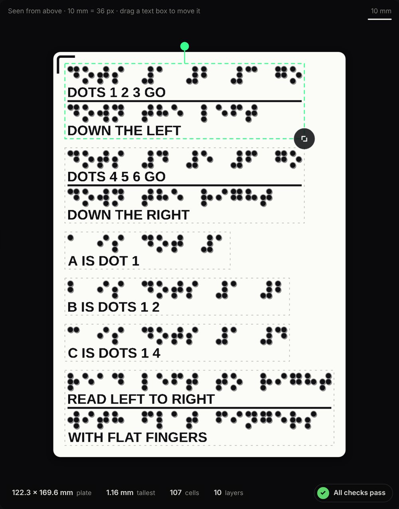

The How to read braille demo plate: dots 1 2 3 down the left, 4 5 6 down the right, and the first letters. Real screen capture of MythaBraille.

## Make your first plate

1. Open MythaBraille and accept the Terms.
2. Open the account menu (the person icon at the top right) and choose Make your first braille plate, and it walks you through the steps below.
3. Type the alphabet into the first text box with a space between the letters: a b c d e f g h i j k l m n o p q r s t u v w x y z.
4. Add a second text box with the numbers: 1 2 3 4 5 6 7 8 9 0.
5. Separation lines are already set to Raised, so a finger can tell where one box ends and the next one starts.
6. In Text settings, turn on Raised print letters for each box, so a sighted helper can read along.
7. Look at it in 3D, check that it says All checks pass, and choose Export .3MF.
8. Open the file in your slicer and print it (the Printing guide below shows how).

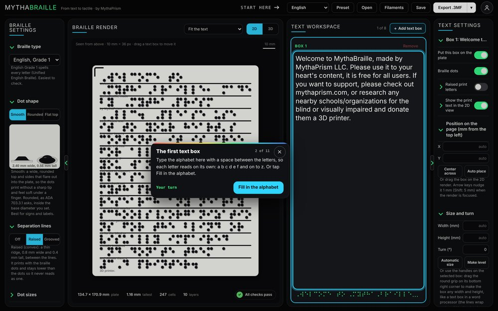

The walkthrough points at each part of the page in turn, with a ring and a short note. Real screen capture of MythaBraille.

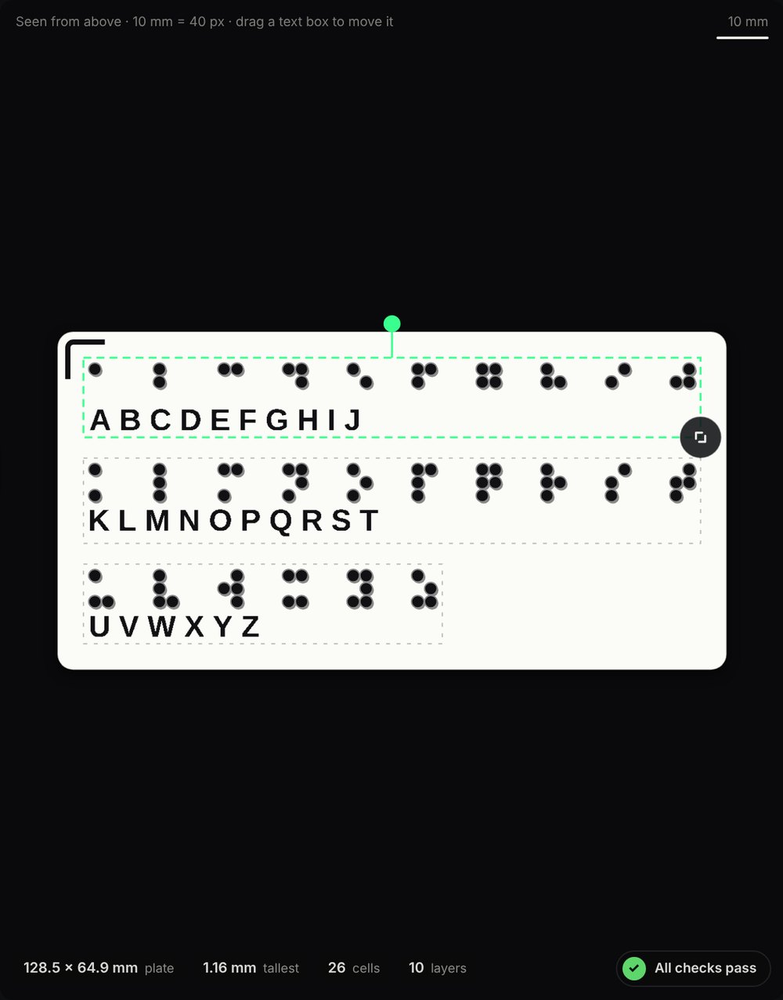

The Alphabet demo plate: a to z in braille with raised letters under each line. Real screen capture of MythaBraille.

## The screen

MythaBraille has four panels, and on a wide screen they sit side by side while on a phone they stack.

- **Braille settings** on the left has the braille type, the dot shape and sides, separation lines, dot sizes, the plate, layer heights and your slicer.
- **Braille render** in the middle shows the plate as it will print, in 2D or 3D, with the page size, the pages and the checks.
- **Text workspace** has one card per text box, and this is where you type.
- **Text settings** on the right has everything about the box you selected.

The top bar holds the screen language, Preset, Open, Filaments, Save, Export .3MF and the account menu. You can drag the dividers between the panels, and the side panels fold away with their arrow buttons. Every group in the side panels also has a chevron next to its name that folds that group away, and the box name at the top of Text settings folds the whole box, so you can keep only the parts you use open. MythaBraille remembers what you folded.

**Screens in Spanish (beta).** The language menu at the left of the top bar switches the screens between English and Español, and a browser that is set to Spanish starts in Spanish. The Terms, the License, the Privacy Policy and this manual stay in English. The screen language never changes the braille itself, because you pick the braille code in Braille type, so the print is the same in either language. Your choice is kept with your work in this browser.

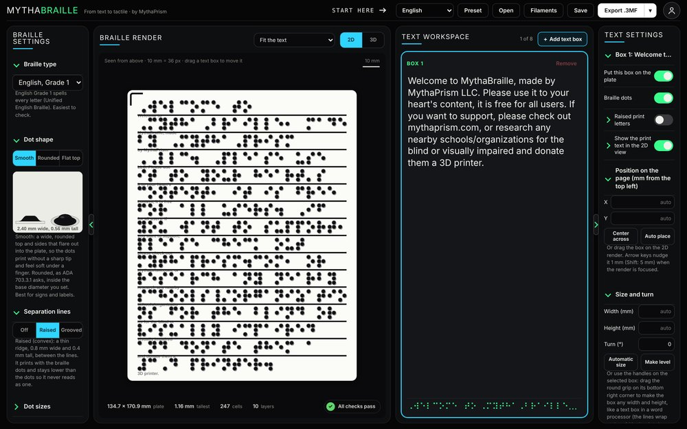

MythaBraille on a computer: braille settings on the left, the render in the middle, your text and its settings on the right. Real screen capture of MythaBraille.

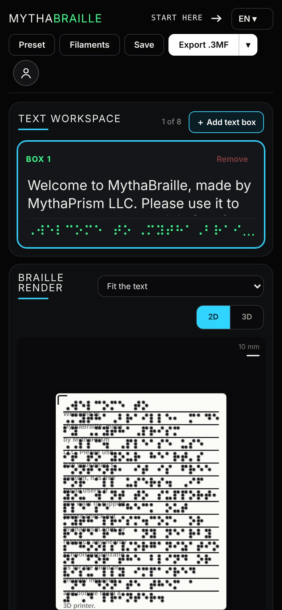

On a phone the same parts stack, text first. Real screen capture of MythaBraille.

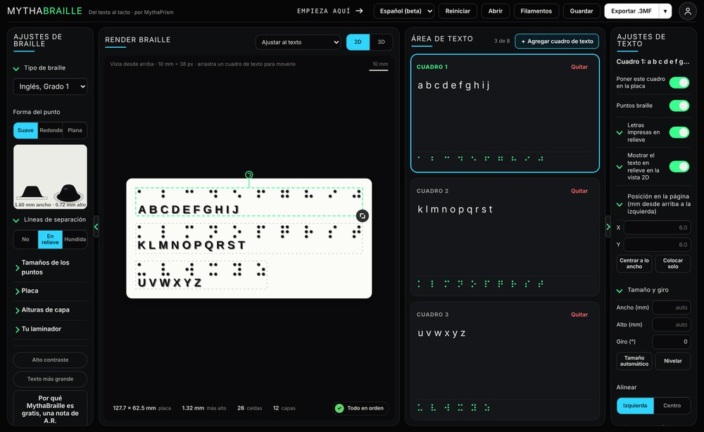

The same page with the screens in Spanish (beta), picked in the language menu at the top. The braille and the print do not change. Real screen capture of MythaBraille.

## Braille settings

**Braille type.** English 1 spells out every letter, and English 2 beta uses the contractions of Unified English Braille. Español beta writes Spanish braille and عربي beta writes Arabic braille. Have every beta checked by a braille reader.

**Dot shape.** Smooth, the default and part of FBM, is a rounded dot with a wide top and sides that flare out into the plate, so it prints without a sharp tip and feels soft under a finger. Rounded is the older dot that narrows to a tip, and on some printers that top layer feels sharp. Flat top is only for labels and art. Smooth and Rounded both have rounded tops the way ADA 703.3.1 asks, and both stay inside the base diameter you set.

**Dot sides.** Sloped, the default, stands on the full width of the dot and slopes in toward the top, so it prints strong and feels smooth. Cylinder has straight sides.

**Separation lines.** Off, Raised or Grooved. A line between the text boxes helps a finger keep its place, and the raised line always stays lower than the dots. Raised is the default with FBM, and Jumbo uses Grooved.

**Preset.** The Preset menu at the top has three choices. **Default (FBM)** is the Filament Braille Method, with 2.4 mm wide, 0.56 mm tall Smooth dots on the standard spacing (2.5 mm in a cell, 6.2 mm cell to cell, 10.1 mm line to line) and raised separation lines. On a filament printer these dots come out round and smooth instead of spiky. FBM is meant for personal use and it is not ADA sizing. **ADA compliant** keeps every size inside the 2010 ADA Standards, Table 703.3.1 (1.6 mm wide, 0.72 mm tall), so use it for public signs. **Jumbo** makes 3.0 mm wide, 1.0 mm tall dots with the spacing 1.25 times wider and grooved separation lines, for fingers that find standard braille hard to feel, and it is not ADA sizing either. If you change any single size, the preset reads Custom.

**Save preset.** The top of the Preset menu has a name box and **Save preset**. Type a name and press it (or Enter), and every MythaBraille setting is kept under that name: the dot sizes and shape, the spacing, the plate, the separation lines, the text settings, the filaments and the print settings. Your presets are listed under the box. Press a name to load it, and press its X to delete it. Saving with a name you already used replaces that preset. Presets stay in this browser on this device, inside MythaBraille's one saved file, and are never sent anywhere.

**Dot sizes.** You can set each size by hand here. The ADA measurements in Table 703.3.1 are dots 1.5 to 1.6 mm wide at the base and 0.64 to 0.94 mm tall, rounded, 2.29 to 2.54 mm apart in a cell, 6.13 to 7.62 mm cell to cell and 10.04 to 10.16 mm line to line, and with the ADA compliant preset a value outside these turns red. Back to the default sizes (FBM) puts everything back. Most cells on a line sets where Fit the text wraps.

**Plate.** The border around the text, the width and height for a custom size, the thickness, the corner rounding and the space between boxes. Plate hint, which is on by default, adds a small raised corner line at the top left of the plate in the dot color, so a reader can tell which way is up before they start reading.

**Layer heights.** The first layer and the plate layers print the plate, and the dot layers are thinner so the dots come out round. Finest, even uses one fine height for every dot layer, and Smooth curve goes from thicker at the base of the dot to the finest at the tip. The picture shows one dot cut in half with a line at the top of every layer.

**Your slicer.** Bambu Studio and OrcaSlicer, PrusaSlicer, or another slicer. For Bambu Studio you can also pick your printer, so the file opens as a full project.

**High contrast and Larger text** make the page easier to see.

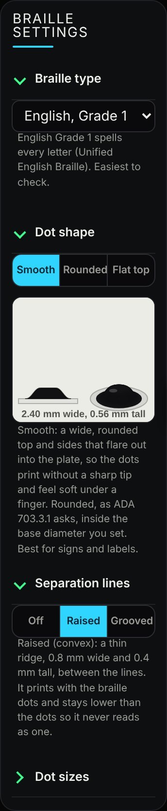

Braille type, dot shape, dot sides and separation lines. Real screen capture of MythaBraille.

## Text boxes and text settings

You can add up to 8 text boxes with + Add text box, and each box is its own block of text on the plate. Select a box to change its settings on the right.

- **Put this box on the plate.** Turn it off to leave the box out of the print.
- **Braille dots.** The braille of the text.
- **Raised print letters.** The same text in raised letters for sighted helpers. Under each line puts small letters under the braille, and Sign (above) puts tall capital letters above the braille the way US signs do.
- **Show the print text in the 2D view.** A guide in the render only, and it never prints.
- **Position.** X and Y in mm from the top left of the page, and empty means automatic. Center across centers the box across the plate, and Auto place puts it back.
- **Width and turn.** A width in mm wraps the text, and Turn rotates the box. Braille is read along a level line, so keep signs level.
- **Line up.** Left or center.
- **Raised letters.** How tall they are, how far they rise, the font and capitals.

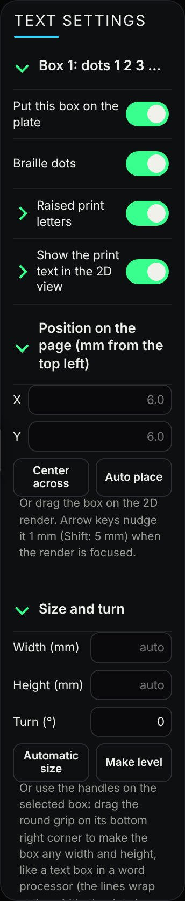

Text settings for one box. Real screen capture of MythaBraille.

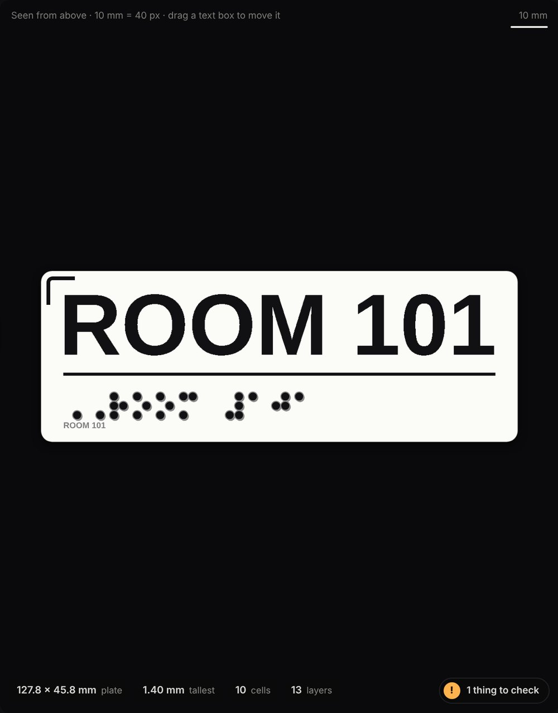

A room sign: tall raised capitals above the braille, seen from above. Real screen capture of MythaBraille.

## The render, pages and checks

Pick a page size above the render: Fit the text, A4, US Letter, A5, A6 or postcard, an index card, a business card, 6 and 8 inch signs, a name badge, a label strip or a custom size. The turn button switches between portrait and landscape. Long text flows onto more pages, and the arrows move between them.

2D shows the plate from above, and 3D shows the real print, which you can drag to turn.

Under the render you see the plate size, the tallest point, the number of cells and the number of layers. The check button says All checks pass, or it lists what to look at, like a size outside the standard, dots that almost touch, letters too close in color to the plate, all capital words on a sign or a turned box. With FBM or Jumbo it also notes that the sizes are not ADA sizes.

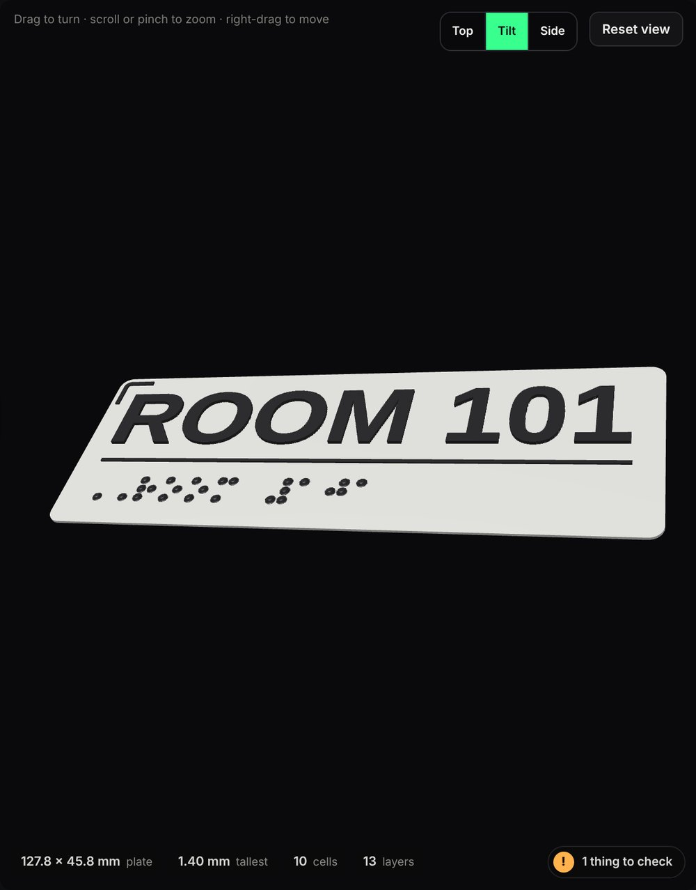

The same sign in 3D, the way it will print. Real screen capture of MythaBraille.

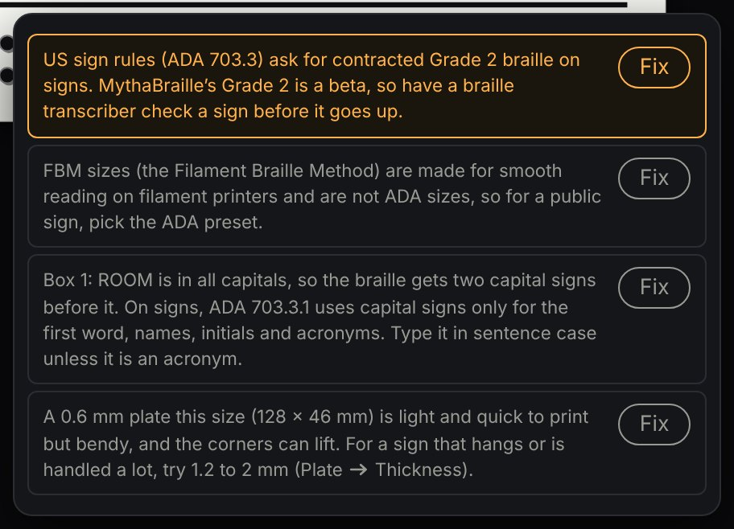

The checks list what to look at, each with a Fix button. Real screen capture of MythaBraille.

## Filaments

The Filaments menu in the top bar sets the colors and which filament prints the plate, the braille dots and the raised letters. The default is a white plate with black dots and black letters, because most people can see that well, and a light on dark or dark on light pair helps people with low vision.

If you have two filaments and one nozzle with no AMS, turn on One nozzle, no AMS, and the printer pauses once at the top of the plate so you can load the second filament.

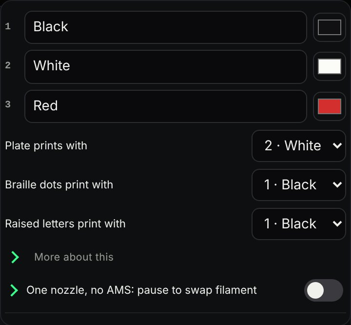

Which filament prints the plate, the dots and the letters. Real screen capture of MythaBraille.

## Export

Export .3MF writes the plate, the dots and the letters as parts with their filaments and every layer height already set. The arrow next to it has Export this page only and Export .STL (one color, for any slicer).

Save downloads your project so you can open it again later with Open, and MythaBraille also keeps one autosave of your work in this browser.

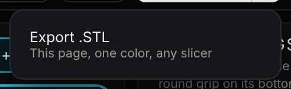

Export .3MF, and the menu next to it. Real screen capture of MythaBraille.

## Printing guide

**Bambu Studio and OrcaSlicer**

1. Open the .3MF, and when Bambu Studio asks, open it as a project so the layer heights and parts come with it.
2. Check the filaments. With a printer picked in Your slicer, the file opens with its three filaments. With Any printer, the slicer keeps the filaments already in your project or AMS, so put the plate color and the dot color in the slots MythaBraille names, or change the slots in MythaBraille to match your AMS.
3. Click each part in the object list and check the filament number next to it, for the plate, the dots and the letters.
4. Slice and open the preview, then move the layer slider up. The plate layers make up the plate height, and then the layers get thin through the dots. If every layer looks the same, the slicer did not read the layer heights, so open the file again as a project.
5. Leave ironing off, because it can flatten the tops of the dots.
6. Print with PLA on a clean plate.

**PrusaSlicer**

1. Open the .3MF, and the parts, extruders and layer heights are already set.
2. Check each part's extruder in the right panel.
3. Slice and check the layer heights with the vertical slider.
4. With an MMU, put the filaments in the extruders MythaBraille names.

**Other slicers (Cura and others)**

Choose Another slicer in Your slicer, and the plate, dots and letters come in as three objects in place. Set their filaments, then set a fine layer height (0.08 mm) for the dot part, or just print the whole plate at 0.08 mm.

**One nozzle, no AMS**

Use two filaments, the plate color and then one color for the dots and letters, and turn on One nozzle, no AMS. The printer pauses at the top of the plate, you load the second filament, and it carries on.

**Tips**

- Print the alphabet plate first and feel it before you print signs.
- If the dots come out stringy, dry your filament and lower the print speed for the top layers.
- A 0.4 mm nozzle is fine, and a 0.2 mm nozzle makes the dots even rounder.

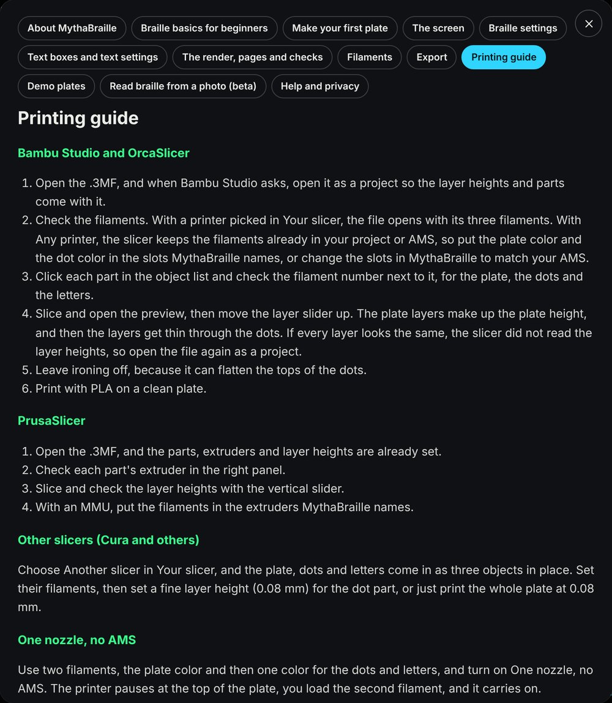

The printing guide opens right in the page. Real screen capture of MythaBraille.

## Demo plates

The account menu has demo plates you can open or download as a .3MF:

- **Alphabet:** a to z with raised letters under each line.
- **Numbers:** 1 to 9 and 0.
- **How to read braille:** the dot numbers and the first letters, with raised letters.
- **First words:** yes, no, hello, thank you.
- **Kitchen labels:** salt, sugar, flour, rice, coffee, tea.
- **Days of the week.**
- **Colors for clothes:** red, blue, green, black, white, gray.
- **Name badge:** type your own name.

Opening a demo replaces the boxes on the plate, and Back to my work in the account menu brings your own boxes back.

**The test staircase**

The Test staircase row saves one test print with every dot shape side by side, so you can feel which one you like before you print a sign. It is 160 x 154 mm and 11.6 mm tall at its top step. The first step says "this is braille" in braille with a raised title, the next five steps are Smooth, Rounded with sloped sides, Rounded with cylinder sides, Flat top with sloped sides and Flat top with cylinder sides at 0.08 mm layers, and the last five steps are the same five shapes at 0.16 mm layers. Every step has its own braille line and a raised label naming its shape and layer height. The file carries a layer height for each step, so your slicer prints every step at its own layer height, and it uses the slicer format and the filaments you picked in Filaments. The same file is free to download on mythaprism.com. It doesn't go on your plate, so your own boxes stay as they are.

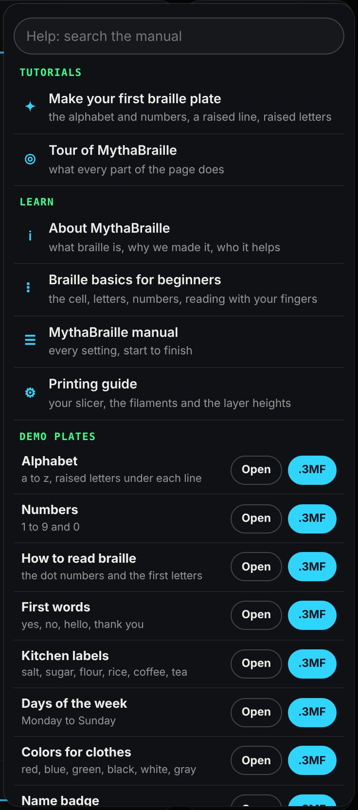

The person icon at the top right: the walkthroughs, the manual, the printing guide and the demo plates. Real screen capture of MythaBraille.

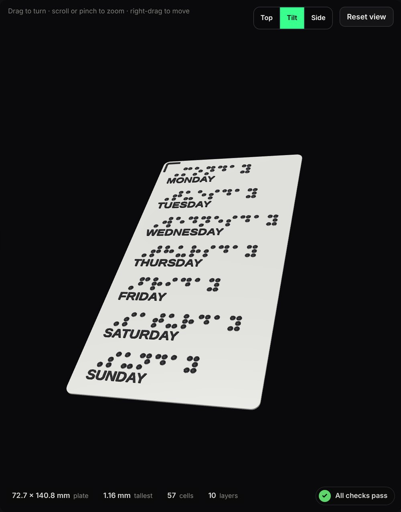

The Days of the week demo plate in the 3D view. Real screen capture of MythaBraille.

## Read braille from a photo (beta)

In the account menu, under Tools, Read braille from a photo (beta) reads the dots in a photo of a braille plate and gives its best estimate of what it says, in English Grade 1 or 2, Spanish or Arabic. It is only an estimate, because one missed or extra dot changes a letter and Grade 2 contractions are guessed, so do not rely on it for medicine, safety, legal or money matters, and have a braille reader check anything that matters. MythaPrism LLC does not promise the reading is right and is not responsible for how it is used.

For the best reading, let the plate fill the photo, take it straight on, and light it from one side so the dots cast small shadows. The dots it found are circled on your photo, and you can copy the text or put it in a new text box. The photo is read on your device and is never uploaded or saved, and closing the window forgets it.

## Help and privacy

The Help box in the account menu searches this manual. MythaBraille runs on your device, keeps one autosave of your work in your browser (local storage named mythabraille.v1) and sends nothing anywhere. If you have a question, write to support@mythaprism.com.

**Start over on this device.** In the account menu, Start over on this device clears that one autosave after asking you first, and MythaBraille opens like your very first visit, with the notice, the welcome and the walkthrough offer and every setting back to its default. Save a copy first if you want to keep your plate.

**Characters with no braille sign.** A character that has no sign in the braille, for example the half brackets some translations put around added words, is left out of the braille and the print with no gap left behind, and the checks tell you which one it was.

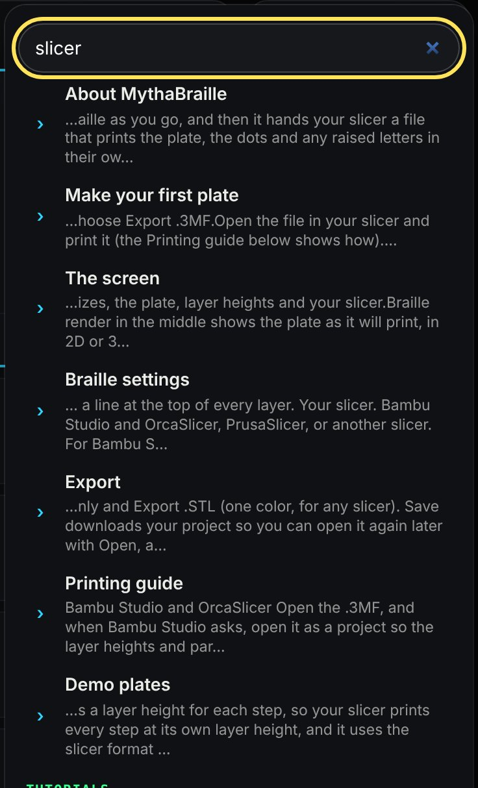

Help search: type a word and the sections that mention it come up. Real screen capture of MythaBraille.
