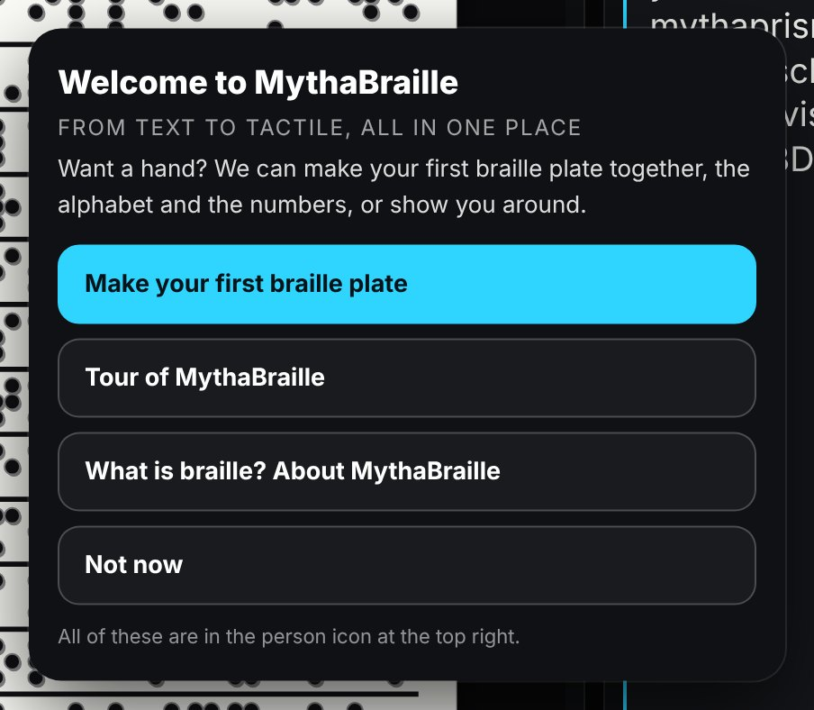
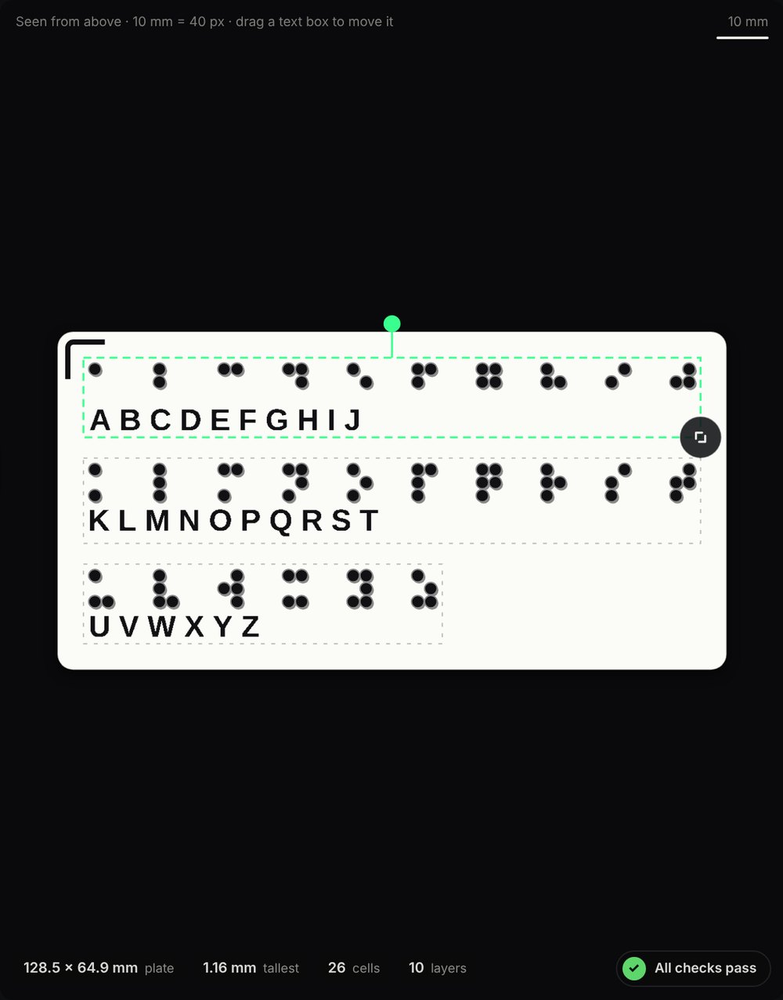
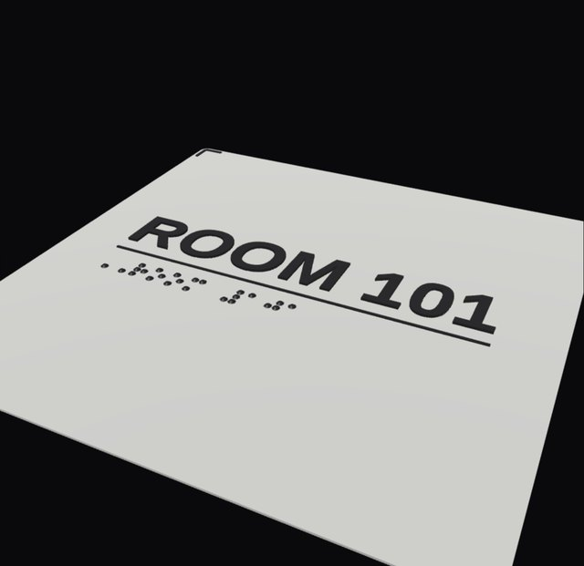

# Quick start: your first plate

Real screen capture of MythaBraille 1.6.5. The welcome card on a first visit.

1. Open [MythaBraille](https://mythaprism.com/braille) and accept the Terms.
2. Open the account menu (the person icon at the top right) and choose **Make your first braille plate**. It walks you through the steps below.
3. Type the alphabet into the first text box with a space between the letters: a b c d e f g h i j k l m n o p q r s t u v w x y z.
4. Add a second text box with the numbers: 1 2 3 4 5 6 7 8 9 0.
5. Separation lines are already set to Raised, so a finger can tell where one box ends and the next one starts.
6. In **Text settings**, turn on Raised print letters for each box, so a sighted helper can read along.
7. Look at it in 3D, check that it says **All checks pass**, and choose **Export .3MF**.
8. Open the file in your slicer and print it. The [Printing guide](manual.md#printing-guide) shows how in Bambu Studio, OrcaSlicer and PrusaSlicer.

The Alphabet demo plate in MythaBraille (real screen capture).

## Then try a sign

Type a room name, turn on raised capitals above the braille, and look at the checks. MythaBraille checks your plate against the sizes in its braille settings and tells you what to fix.

Braille on public signs has rules (in the US, ADA section 703). MythaBraille's checks help, but they do not replace a braille transcriber. Please have a sign checked before it goes up.
