# MythaBraille videos

Real screen recordings of MythaBraille 1.6.5, played at real speed with nothing sped up. Click a picture to open its video.

MythaBraille is not an official or ADA-certified product. Have braille checked by a qualified braille reader, and please do not use it alone for emergency, safety, medical or legal information. Grade 2 is a beta.

## Tutorials

| Video | What it shows |
|:---:|:---|
| <a href="01_your_first_braille_sign.mp4">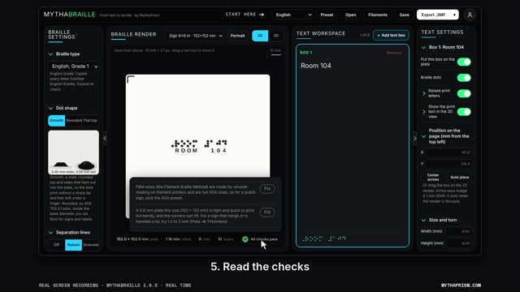</a> | **Your first braille sign** (0:36) 1. Type your words · 2. Pick a page size · 3. Add raised print letters · 4. Choose the dot shape · 5. Read the checks · 6. Check it in 3D |
| <a href="02_tour_of_mythabraille.mp4">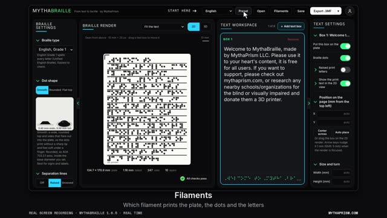</a> | **A tour of MythaBraille** (0:48) A quick tour of MythaBraille · Braille settings · Braille render · Text workspace · Text settings · Open |
| <a href="03_braille_settings_explained.mp4">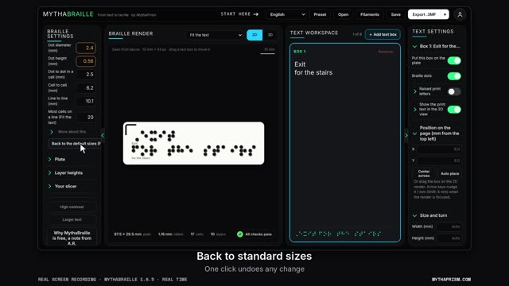</a> | **Braille settings, explained** (1:28) Braille settings, one by one · Braille type: English, Grade 1 · Grade 2 is a beta · Dot shape: Smooth, Rounded or Flat top · The live preview · Separation lines |
| <a href="04_the_render_explained.mp4">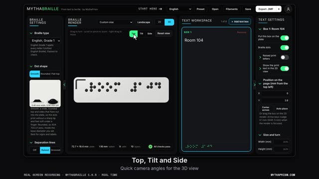</a> | **The render, explained** (0:50) The braille render · Page size · Drag a box to move it · 2D from above, or 3D · Top, Tilt and Side · Reset view |
| <a href="05_text_boxes_explained.mp4">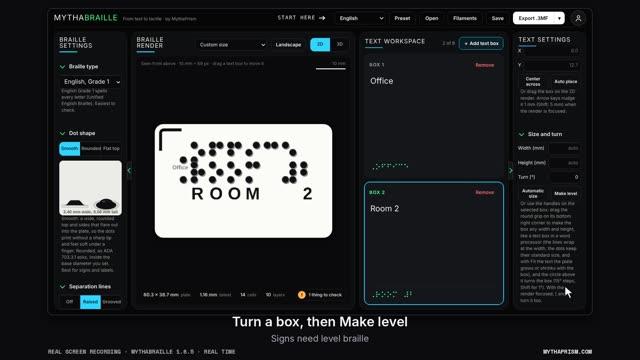</a> | **Text boxes, explained** (1:13) Text boxes and their settings · Add text box · Put this box on the plate · Braille dots · Raised print letters · Show the print text in the 2D view |

## Every feature, one at a time

| Video | What it shows |
|:---:|:---|
| <a href="01_type_to_braille.mp4">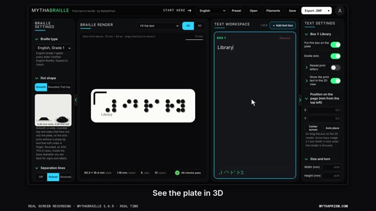</a> | **Type to braille** (0:24) Type the words you want in braille · The braille appears as you type · See the plate in 3D |
| <a href="02_dot_shapes.mp4">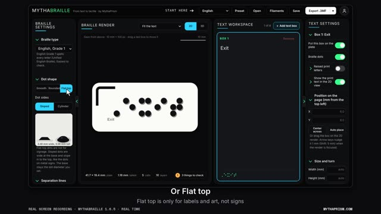</a> | **Dot shapes** (0:27) Dot shape: Smooth · Or Flat top · Both in 3D |
| <a href="03_smooth_and_rounded.mp4">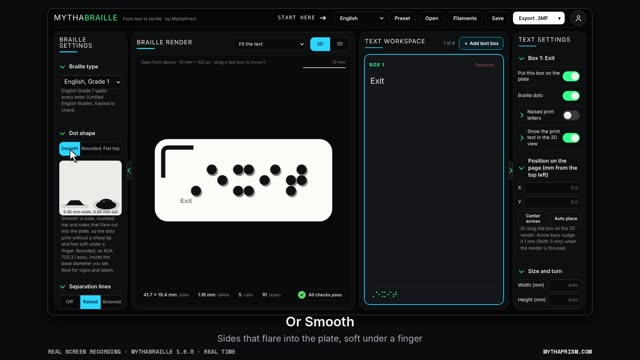</a> | **Smooth and Rounded** (0:22) Dot shape: Rounded · Or Smooth · The live preview shows the dot from the side |
| <a href="04_separation_lines.mp4">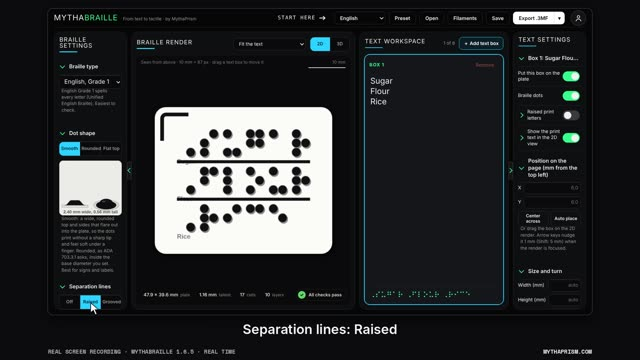</a> | **Separation lines** (0:29) Separation lines go between the rows · Separation lines: Off · Separation lines: Raised · Separation lines: Grooved · In 3D |
| <a href="05_raised_print_letters.mp4">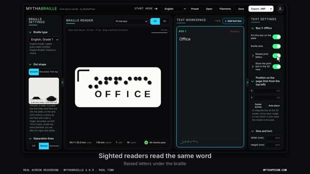</a> | **Raised print letters** (0:24) Turn on raised print letters · Sighted readers read the same word · In 3D |
| <a href="06_page_sizes.mp4">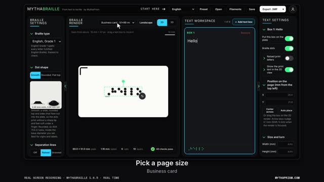</a> | **Page sizes** (0:35) Pick a page size · Pick a page size · Pick a page size · Pick a page size · Pick a page size |
| <a href="07_room_sign.mp4">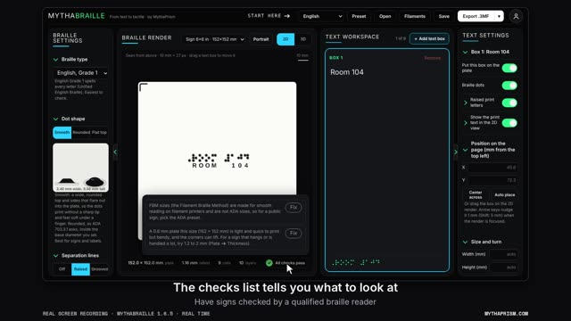</a> | **A room sign** (0:30) A room sign: Room 104 · Raised capitals above the braille · The checks list tells you what to look at · In 3D |
| <a href="08_pantry_labels.mp4">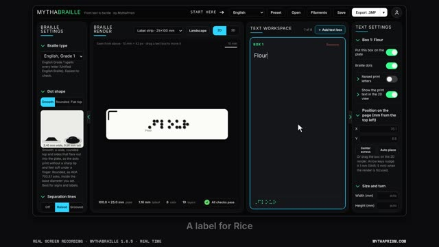</a> | **Pantry labels** (0:29) Pantry labels · A label for Sugar · A label for Flour · A label for Rice · One strip for each jar |
| <a href="09_learning_cards.mp4">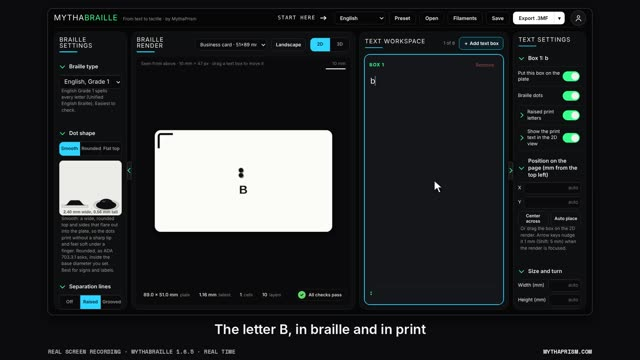</a> | **Learning cards** (0:28) Learning cards · The letter A, in braille and in print · The letter B, in braille and in print · The letter C, in braille and in print · The letter D, in braille and in print |
| <a href="10_export_3mf.mp4">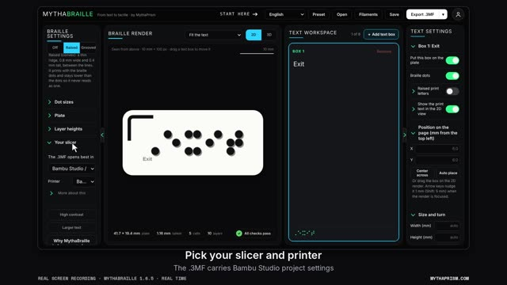</a> | **Export the .3MF** (0:25) Pick the filaments · Pick your slicer and printer · Export the .3MF for your slicer |
| <a href="11_accessibility.mp4">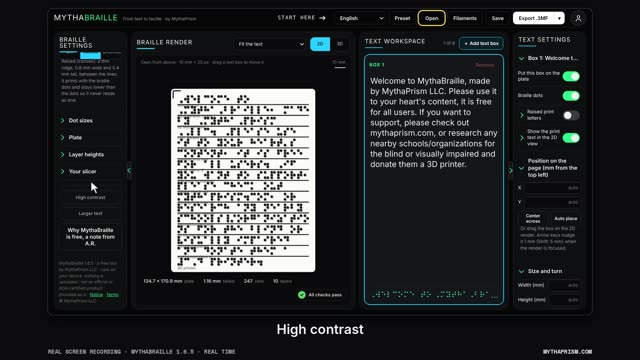</a> | **Keyboards and screen readers** (0:24) Built for keyboards and screen readers · High contrast · Larger text |
| <a href="12_grade2_beta.mp4">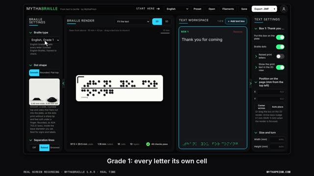</a> | **Grade 2 (beta)** (0:21) Grade 1: every letter its own cell · Grade 2 beta: contractions, fewer cells |
